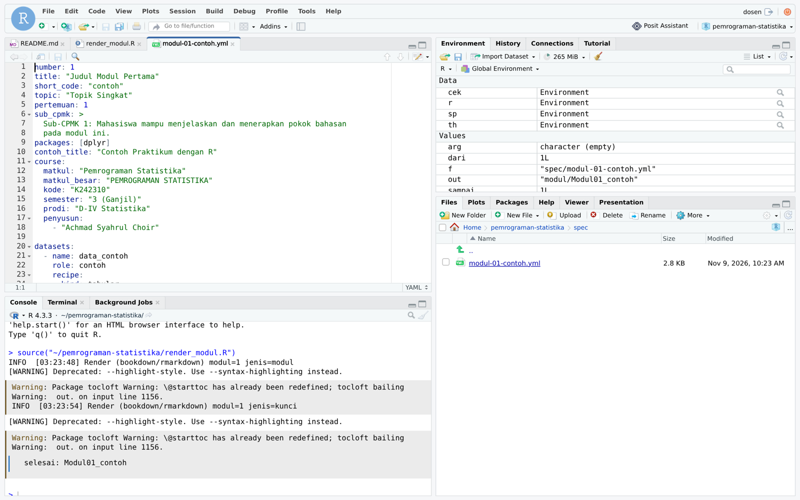
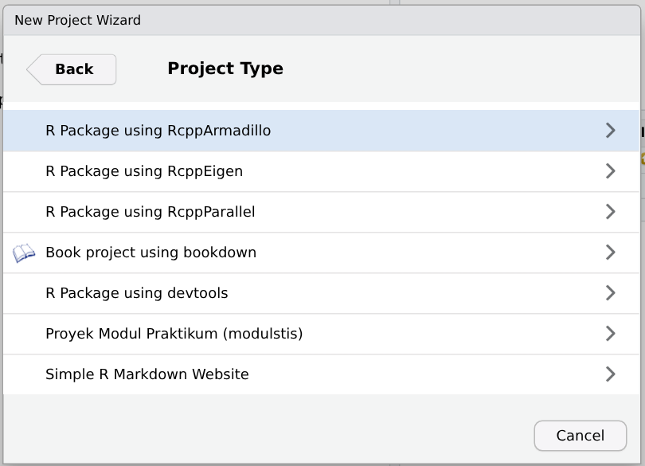
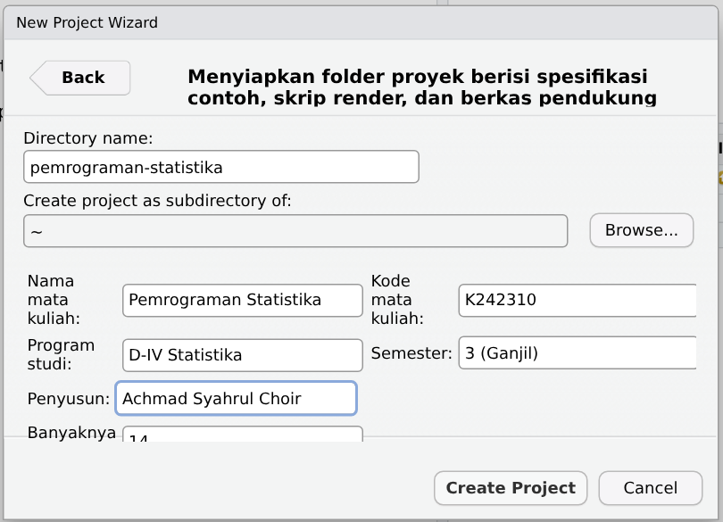
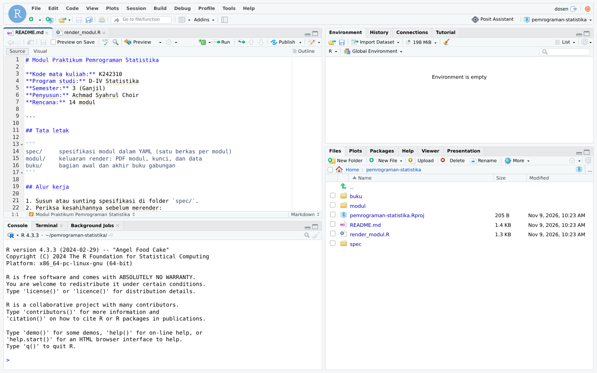
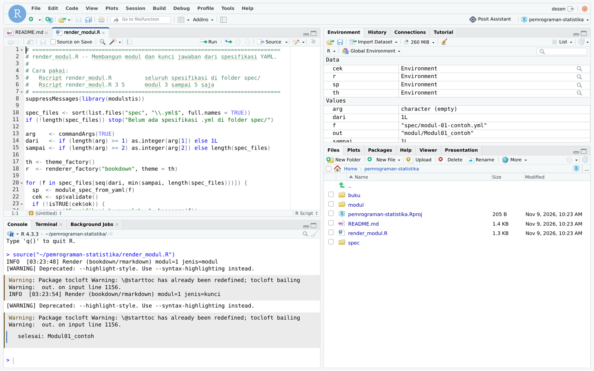
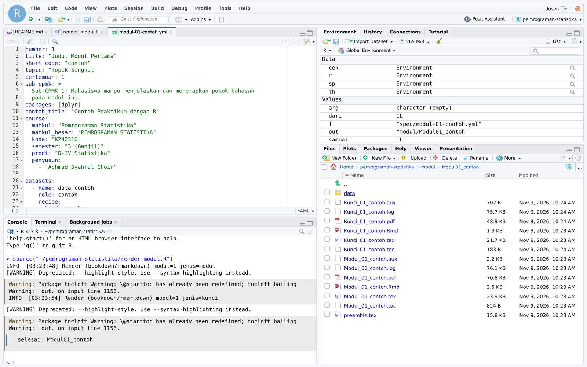
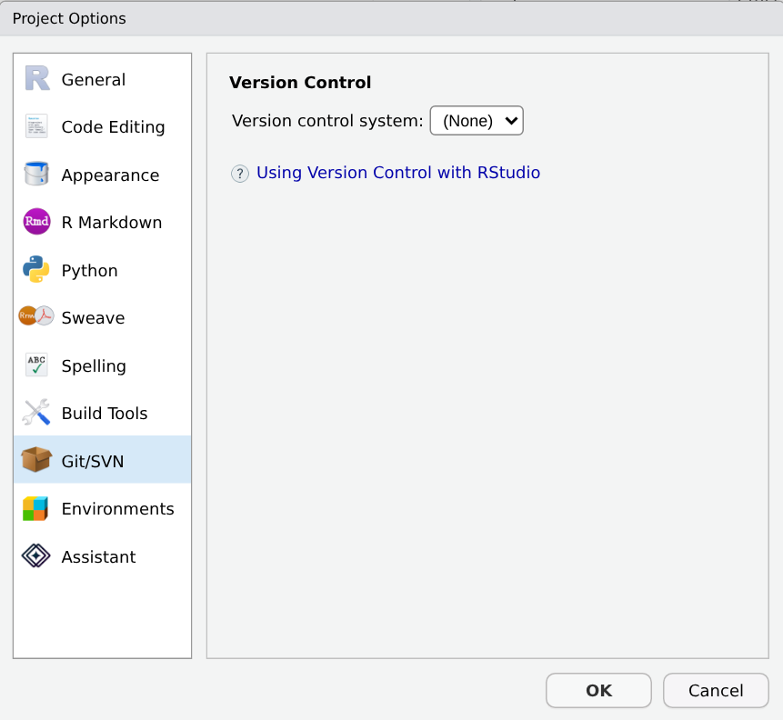

# Bahasa Pemrograman, Perangkat, dan Contoh Penggunaan {#sec-penggunaan}

```{r}
#| include: false
source("_setup.R")
unlink(PROYEK, recursive = TRUE)
```

Bab ini menjelaskan bahasa pemrograman dan perangkat yang dipakai `modulstis`, cara memasangnya di
Windows, macOS, dan Linux, serta contoh penggunaan aplikasi dari awal sampai akhir. Contoh memakai
mata kuliah **Pemrograman Statistika** (K242310) Program Studi D-IV Statistika, khususnya **Modul 7:
Statistik Deskriptif dan Eksplorasi Data**.

## Bahasa pemrograman dan format

### R

R adalah bahasa pemrograman untuk komputasi statistik. Seluruh kode `modulstis` ditulis dalam R,
dan R juga menjalankan kode contoh serta kode solusi di dalam modul. Pengguna memakai aplikasi
dengan memanggil fungsinya dari Console R:

```{r}
#| eval: false
library(modulstis)
sp <- module_spec_from_yaml("spec/modul-07-deskriptif.yml")
render_module(sp, output_dir = "build")
```

### R6

R6 adalah paket R untuk pemrograman berorientasi objek dengan kelas yang dapat diubah isinya
(*mutable*). Semua komponen inti `modulstis` adalah kelas R6. Objek dibuat dengan `$new()`, dan
metodenya dipanggil dengan tanda `$`:

```{r}
#| eval: false
proj <- ModuleProject$new(specs_dir = "spec", output_dir = "build")
proj$validate_all()
proj$render_all()
```

### YAML

YAML adalah format teks untuk data berstruktur. Spesifikasi modul ditulis dalam YAML. Ada lima
aturan yang perlu diketahui:

1. setiap baris berbentuk `kunci: nilai`, dengan satu spasi sesudah titik dua;
2. indentasi menyatakan bagian mana yang termasuk ke dalam bagian mana, dan **harus memakai spasi**,
   bukan tab (buku ini memakai dua spasi per tingkat);
3. butir daftar diawali tanda hubung dan satu spasi;
4. teks panjang ditulis sesudah `>` bila baris-barisnya boleh disambung menjadi satu paragraf, atau
   sesudah `|` bila setiap baris harus dipertahankan, seperti pada kode;
5. nilai yang memuat titik dua, tanda pagar, atau diawali tanda khusus ditulis di antara tanda kutip.

```yaml
number: 7
title: "Statistik Deskriptif dan Eksplorasi Data"
course:
  matkul: "Pemrograman Statistika"
  penyusun:
    - "Achmad Syahrul Choir"
```

### Markdown dan R Markdown

Teks di dalam spesifikasi ditulis dengan penanda Markdown, misalnya `**tebal**`, `*miring*`,
`` `kode` ``, dan daftar bernomor `1.`. Aplikasi merakit isi spesifikasi menjadi berkas R Markdown
(`.Rmd`), yaitu Markdown yang dapat memuat potongan kode R. Potongan kode itu dijalankan oleh knitr
ketika modul dirender.

### LaTeX

LaTeX adalah bahasa penyusun dokumen yang dipakai untuk menghasilkan PDF. Sampul, kepala halaman,
warna, dan kotak sudah disiapkan aplikasi, sehingga pengguna hanya menulis LaTeX untuk rumus dan
kotak khusus, misalnya:

```latex
\begin{kotakrumus}
Ragam contoh:\quad $s^{2} = \dfrac{1}{n-1}\sum_{i=1}^{n}(x_i - \bar{x})^{2}$
\end{kotakrumus}
```

Kotak yang dapat dipakai di isi modul antara lain `kotakinfo`, `kotakcatatan`, `kotakperhatian`,
`kotaksalah`, `kotaktips`, `kotakvariasi`, `kotakrumus`, `kotaktujuan`, `kotaktugas`, dan
`kotakkunci`. Kotak *Penjelasan Kode* dan *Interpretasi Output* pada contoh dibuat otomatis oleh
aplikasi.

### Python (opsional)

Contoh dan solusi dapat memuat kode Python di samping kode R melalui kunci `kode_py` dan `solusi_py`.
Kode Python dijalankan oleh paket R `reticulate`. Bagian ini opsional; modul yang hanya memuat kode R
tidak memerlukan Python.

## Perangkat yang digunakan

| Perangkat | Versi minimum | Peran dalam `modulstis` | Wajib |
|:--|:--|:--|:-:|
| R | 4.1 | menjalankan aplikasi dan kode di modul | ya |
| RStudio | 2023 ke atas | lingkungan kerja; menyediakan templat proyek dan *add-in* | dianjurkan |
| Paket `R6`, `yaml`, `purrr`, `fs` | -- | kelas objek, pembaca YAML, iterasi, dan berkas; terpasang otomatis | ya |
| Paket `rmarkdown`, `knitr`, `bookdown` | -- | merakit dan menjalankan dokumen R Markdown | ya |
| Pandoc | 2.x | mengubah Markdown menjadi LaTeX; disertakan bersama RStudio | ya |
| TinyTeX (XeLaTeX) | -- | menyusun PDF | ya |
| Pola pemenggalan `hyph-id` | -- | memenggal kata bahasa Indonesia sesuai kaidah | ya |
| Font Carlito | -- | huruf utama modul, ukurannya setara Calibri | ya |
| Paket `pdftools`, `qpdf` | -- | menghitung halaman dan menggabung PDF | ya |
| Paket `dplyr`, `tidyr` | -- | dipakai oleh contoh di spesifikasi bawaan Pemrograman Statistika | dianjurkan |
| Quarto dan paket `quarto` | 1.4 | backend Quarto | tidak |
| Python dan paket `reticulate` | -- | kode Python di modul | tidak |
| Git | -- | mencatat riwayat perubahan spesifikasi | dianjurkan |
| `testthat` | 3.0 | pengujian otomatis paket | pengembang |

: Perangkat yang digunakan {#tbl-perangkat}

## Pemasangan

Pemasangan memerlukan koneksi internet. Pasang berurutan sesuai langkah berikut.

Beberapa perintah dijalankan di **terminal** sistem operasi, bukan di Console R. Blok perintah
semacam itu diberi tanda `bash`. Terminal dapat dibuka dari tab **Terminal** di RStudio (panel kiri
bawah), dari aplikasi **Terminal** di macOS, atau dengan **Ctrl+Alt+T** di Ubuntu.

\langkah{Pasang R dan RStudio}

Unduh R dari <https://cran.r-project.org> dan RStudio Desktop dari
<https://posit.co/download/rstudio-desktop/>, lalu pasang seperti aplikasi biasa.

\windows{} Pilih **Download R for Windows → base**, lalu jalankan berkas `.exe` yang terunduh.

\macos{} Pilih berkas `.pkg` berakhiran `arm64` untuk Mac dengan cip Apple (M1, M2, dan seterusnya),
atau `x86_64` untuk Mac dengan prosesor Intel.

\linux{} Pada Ubuntu atau Debian:

```bash
sudo apt update
sudo apt install r-base r-base-dev
```

\langkah{Pasang TinyTeX dan pola pemenggalan Indonesia}

Jalankan di Console RStudio, lalu tutup dan buka kembali RStudio:

```{r}
#| eval: false
install.packages("tinytex")
tinytex::install_tinytex()
tinytex::tlmgr_install("hyphen-indonesian")
```

\linux{} Bila memakai TeX Live dari repositori distro, bukan TinyTeX, pasang:

```bash
sudo apt install texlive-xetex texlive-latex-extra texlive-lang-other
```

\langkah{Pasang font Carlito}

\windows{} Unduh dari <https://fonts.google.com/specimen/Carlito> (**Get font → Download all**),
ekstrak berkas ZIP, pilih keempat berkas `.ttf`, klik kanan, lalu pilih **Install for all users**.
Pada Windows 11, pilihan itu ada di bawah **Show more options**.

\macos{} Jalankan `brew install --cask font-carlito` di Terminal, atau unduh dari Google Fonts lalu
klik dua kali setiap berkas `.ttf` dan pilih **Install Font**.

\linux{} Jalankan `sudo apt install fonts-crosextra-carlito`.

::: {.callout-warning}
Di Windows, pilih **Install for all users**, bukan sekadar **Install**. Pilihan **Install** menaruh
font di folder milik satu akun saja, dan XeLaTeX sering tidak menemukannya di sana.
:::

\langkah{Pasang paket R pendukung}

\linux{} Paket `pdftools` memerlukan pustaka Poppler. Pasang lebih dahulu di terminal:

```bash
sudo apt install libpoppler-cpp-dev
```

Kemudian, di ketiga sistem operasi, jalankan di Console R:

```{r}
#| eval: false
install.packages(c("rmarkdown", "bookdown", "knitr", "pdftools", "qpdf",
                   "dplyr", "tidyr", "remotes"))
```

Bila ingin memakai backend Quarto, pasang Quarto dari <https://quarto.org/docs/get-started/>, lalu
jalankan `install.packages("quarto")`. Langkah ini dapat dilewati.

\langkah{Pasang modulstis}

```{r}
#| eval: false
remotes::install_github("madsyair/modulstis")
```

::: {.callout-note}
\windows{} Peringatan bahwa **Rtools** diperlukan boleh diabaikan, karena `modulstis` seluruhnya
ditulis dalam R. Pemasangan berhasil bila diakhiri dengan pesan `* DONE (modulstis)`.
:::

## Memeriksa kesiapan

\langkah{Jalankan pemeriksaan kesiapan}

```{rproyek}
#| wd: !expr KERJA
library(modulstis)
cek_kesiapan()
```

Untuk font dan pola pemenggalan, `cek_kesiapan()` benar-benar menyusun dokumen kecil dengan XeLaTeX,
sehingga hasilnya berlaku sama di ketiga sistem operasi. Komponen yang belum siap ditandai `[BELUM]`
beserta sarannya. Contoh berikut adalah keluaran pada komputer yang belum memiliki XeLaTeX:

```{rproyek}
#| wd: !expr KERJA
#| echo: false
Sys.setenv(PATH = file.path(R.home(), "bin"))
library(modulstis)
cek_kesiapan()
```

Kerjakan saran pada baris `[BELUM]` dari atas ke bawah, lalu jalankan `cek_kesiapan()` lagi sampai
semua komponen wajib bertanda `[OK]`.

## Contoh penggunaan

### Membuat proyek modul

Proyek RStudio adalah folder yang dibuka sebagai satu kesatuan kerja. Ketika proyek dibuka, folder
itu menjadi direktori kerja, sehingga nama berkas dapat ditulis pendek tanpa jalur lengkap.

@fig-rstudio memperlihatkan empat panel RStudio yang dirujuk pada bagian ini: **Source** untuk
menyunting berkas, **Console** untuk menjalankan perintah R, **Environment** untuk melihat objek,
dan **Files** untuk menjelajah folder.

{#fig-rstudio width="100%"}

::: {.callout-note}
Tangkapan layar diambil dari RStudio Server versi 2026.10.1. RStudio Desktop di Windows, macOS, dan
Linux memiliki menu, panel, dan dialog yang sama.
:::

\langkah{Buat proyek dari menu RStudio}

Pilih **File → New Project → New Directory**. Dalam daftar **Project Type**, gulir ke bawah dan pilih
**Proyek Modul Praktikum (modulstis)** (@fig-proyek-jenis). Pilihan ini tersedia setelah `modulstis`
terpasang.

{#fig-proyek-jenis width="62%"}

Isi kotak isian seperti @tbl-isian-proyek, lalu klik **Create Project** (@fig-proyek-isian). Isian
**Banyaknya modul** dan kotak centang di bawahnya baru terlihat setelah isi kotak dialog digulir ke
bawah.

| Isian | Nilai untuk contoh |
|:--|:--|
| Directory name | `pemrograman-statistika` |
| Create project as subdirectory of | folder induk proyek; klik **Browse...**, misalnya pilih `Documents` |
| Nama mata kuliah | Pemrograman Statistika |
| Kode mata kuliah | K242310 |
| Program studi | D-IV Statistika |
| Semester | 3 (Ganjil) |
| Penyusun | nama penyusun |
| Banyaknya modul | 14 |
| Sertakan spesifikasi contoh | dicentang |

: Isian proyek baru {#tbl-isian-proyek}

{#fig-proyek-isian width="62%"}

RStudio memulai ulang sesi R dan membuka proyek baru. Panel Source membuka `README.md` dan
`render_modul.R`, dan panel Files menampilkan isi folder proyek (@fig-proyek-terbuka).

{#fig-proyek-terbuka width="100%"}

Proyek yang sama dapat dibuat tanpa menu, dengan perintah berikut di Console. Sebelum menjalankannya,
pilih folder induk lewat **Session → Set Working Directory → Choose Directory...**:

```{rproyek}
#| wd: !expr KERJA
library(modulstis)
buat_proyek_modul("pemrograman-statistika",
  matkul = "Pemrograman Statistika", kode = "K242310",
  prodi = "D-IV Statistika", semester = "3 (Ganjil)",
  penyusun = "Achmad Syahrul Choir", n_modul = 14)
```

Folder proyek berisi:

| Isi | Kegunaan |
|:--|:--|
| `spec/` | spesifikasi, satu berkas `.yml` per modul; sudah berisi `modul-01-contoh.yml` |
| `modul/` | hasil render `render_modul.R`; dibuat ulang setiap kali merender |
| `buku/` | bagian awal dan hasil antara buku gabungan |
| `render_modul.R` | skrip yang merender semua spesifikasi di `spec/` |
| `README.md` | catatan proyek dan prasyaratnya |
| `pemrograman-statistika.Rproj` | berkas proyek RStudio (hanya bila dibuat lewat menu); klik dua kali untuk membuka proyek |

: Isi folder proyek {#tbl-isi-proyek}

### Merender spesifikasi contoh

\langkah{Render dengan skrip proyek}

Buka tab `render_modul.R` di panel Source, lalu klik tombol **Source** pada bilah alat panel itu
(@fig-render-source). Perintah yang setara di Console adalah:

```{rproyek}
source("render_modul.R")
```

{#fig-render-source width="100%"}

Baris `INFO` adalah catatan kerja aplikasi, satu untuk modul dan satu untuk kunci. Peringatan
`Package tocloft Warning` dari LaTeX dan `[WARNING] Deprecated: --highlight-style` dari Pandoc tidak
memengaruhi hasil. Baris terakhir menyebut folder hasilnya.

::: {.callout-tip}
Panel Files menampilkan folder `modul/Modul01_contoh/` yang berisi `Modul_01_contoh.pdf`,
`Kunci_01_contoh.pdf`, folder `data/`, dan berkas antara `.Rmd`, `.tex`, serta `.log`
(@fig-hasil-files). Klik nama berkas PDF untuk membukanya.
:::

{#fig-hasil-files width="100%"}

::: {.callout-warning}
Folder `modul/` berisi hasil, bukan sumber. Perubahan yang dibuat langsung pada PDF atau berkas
antara di folder itu akan hilang pada render berikutnya. Isi modul hanya disunting di berkas `.yml`
di folder `spec/`.
:::

### Menulis spesifikasi Modul 7

\langkah{Buat berkas spesifikasi}

Di panel Files, buka folder `spec`, lalu pilih **New Blank File → Text File** (pada sebagian versi
RStudio tombolnya bertuliskan **New File**). Beri nama `modul-07-deskriptif.yml`. Isi berkas itu
dengan spesifikasi Modul 7. Spesifikasi lengkapnya dimuat di @sec-lampiran-e; bagian-bagian
pokoknya dijelaskan di bawah.

```{r}
#| include: false
pasang_modul7()
SPEC7 <- SPEC7_CONTOH
```

**Identitas dan mata kuliah.** Nilai-nilai ini dicetak di sampul dan kepala halaman:

```{r}
#| echo: false
#| output: asis
tampil_berkas(SPEC7, baris = baris_dari(SPEC7, "^number:", "^datasets:"))
```

**Resep data.** Data `data_rumahtangga` berisi 60 amatan, dibangkitkan dengan *seed* 2025, dan
ditulis ke `data/data_rumahtangga.csv`:

```{r}
#| echo: false
#| output: asis
tampil_berkas(SPEC7, baris = baris_dari(SPEC7, "^datasets:", "^# Susunan bagian") |> head(-1))
```

**Isi bagian.** Setiap bagian ditulis di bawah `body` dengan nama sesuai `id` bagian. Berikut satu
contoh praktikum yang kodenya dijalankan saat render (`eval: true`):

```{r}
#| echo: false
#| output: asis
tampil_berkas(SPEC7, baris = baris_dari(SPEC7, "^  contoh:", "^    - contoh: \"Ukuran pemusatan"))
```

**Latihan dan solusi.** Soal ditulis di `body` → `latihan`, sedangkan solusi, skor, dan pembahasan
ditulis di `exercises`. Bagian `exercises` hanya dicetak di kunci jawaban:

```{r}
#| echo: false
#| output: asis
tampil_berkas(SPEC7, baris = baris_dari(SPEC7, "^exercises:", "^  - id: \"L7.2\""))
```

### Memeriksa spesifikasi

\langkah{Validasi sebelum merender}

```{rproyek}
library(modulstis)
sp7 <- module_spec_from_yaml("spec/modul-07-deskriptif.yml")
sp7$validate()
```

Validasi hanya memakan beberapa detik, sedangkan render memakan puluhan detik. Bila ada pelanggaran,
semuanya dilaporkan sekaligus. Contoh berikut mengubah objek di memori, bukan berkasnya, untuk
memperlihatkan laporan spesifikasi yang tidak valid:

```{rproyek}
salah <- module_spec_from_yaml("spec/modul-07-deskriptif.yml")
salah$number <- 120
salah$exercises[[1]]$points <- NULL
salah$validate()
```

### Merender modul dan kunci jawaban

\langkah{Render satu modul}

```{rproyek}
h7 <- render_module(sp7, output_dir = "build")
c(h7$modul$path, h7$kunci$path)
list.files("build/modul-07/data")
```

```{r}
#| include: false
pm <- file.path(PROYEK, "build", "modul-07", "Modul_07_deskriptif.pdf")
pk <- file.path(PROYEK, "build", "kunci-07", "Kunci_07_deskriptif.pdf")
g1 <- halaman_png(pm, 1, "modul7")
g2 <- halaman_png(pm, cari_halaman(pm, "Contoh 7\\.1"), "modul7")
g3 <- halaman_png(pk, cari_halaman(pk, "L7\\.1"), "kunci7")
n_m <- pdf_halaman(pm); n_k <- pdf_halaman(pk)
```

Dari satu spesifikasi, aplikasi menghasilkan modul `r n_m` halaman, kunci jawaban `r n_k` halaman,
dan satu berkas data. @fig-modul7 memperlihatkan tiga halamannya.

```{r}
#| label: fig-modul7
#| echo: false
#| fig-cap: "Keluaran Modul 7 dari satu spesifikasi."
#| fig-subcap:
#|   - "Sampul modul"
#|   - "Contoh praktikum beserta keluaran kodenya"
#|   - "Kunci jawaban"
#| layout-ncol: 3
knitr::include_graphics(c(g1, g2, g3))
```

Blok berwarna di bawah kode pada halaman contoh adalah keluaran R saat modul dirender. Nilai di
kunci jawaban dihitung dari berkas data yang sama.

### Merender seluruh mata kuliah

Paket menyertakan spesifikasi empat belas modul Pemrograman Statistika di folder `specs_ps`. Contoh
berikut mengganti spesifikasi contoh dengan Modul 5 bawaan, lalu merender semua spesifikasi di
folder `spec/` sekaligus.

\langkah{Render semua spesifikasi dengan ModuleProject}

```{rproyek}
file.remove("spec/modul-01-contoh.yml")
file.copy(system.file("specs_ps", "modul-05-dplyr.yml", package = "modulstis"), "spec")
proj <- ModuleProject$new(specs_dir = "spec", output_dir = "build")
proj$validate_all()
hasil <- proj$render_all()
```

::: {.callout-tip}
Log diakhiri satu baris `OK` untuk setiap modul. Bila satu modul gagal, barisnya bertuliskan
`GAGAL` beserta pesannya, sedangkan modul lain tetap dirender.
:::

Tiga cara merender dapat dipilih sesuai keperluan:

| Cara | Cakupan | Folder hasil |
|:--|:--|:--|
| `render_module()` | satu modul; cocok selama menyunting | `build/modul-NN/` dan `build/kunci-NN/` |
| `ModuleProject` | semua spesifikasi di satu folder | `build/modul-NN/` dan `build/kunci-NN/` |
| `render_modul.R` | semua spesifikasi, atau rentang urutan berkas bila dijalankan dengan `Rscript render_modul.R 2 3` | `modul/ModulNN_kode/` |

: Tiga cara merender {#tbl-cara-render}

Backend Quarto dipilih dengan argumen `backend = "quarto"` pada `render_module()` atau
`ModuleProject$new()`. Isi dan tampilan modul sama; berkas antaranya `.qmd`, bukan `.Rmd`.

### Menyusun buku modul dan buku kunci

```{r}
#| include: false
file.copy(file.path(PEDOMAN, "contoh", "bagian_awal.Rmd"),
          file.path(PROYEK, "buku"), overwrite = TRUE)
file.copy(file.path(PEDOMAN, "contoh", "susun_buku.R"), PROYEK, overwrite = TRUE)
```

\langkah{Siapkan bagian awal buku}

Buat berkas `buku/bagian_awal.Rmd` lewat **File → New File → Text File**, tempel isi berikut, lalu
simpan. Berkas ini membuat sampul buku dengan `sampul_buku()`, kata pengantar, dan daftar modul.
Parameter `params$jenis` di bagian atas berkas menentukan buku yang disusun, yaitu `"modul"` atau
`"kunci"`. Nilainya diteruskan ke argumen `varian` dari `sampul_buku()`, yang memilih pita biru untuk
modul atau pita hijau untuk kunci.

```{r}
#| echo: false
#| output: asis
tampil_berkas(file.path(PEDOMAN, "contoh", "bagian_awal.Rmd"), bahasa = "markdown")
```

\langkah{Jalankan skrip penyusun buku}

Simpan skrip berikut sebagai `susun_buku.R` di folder proyek, lalu jalankan dengan
`source("susun_buku.R")` di Console atau `Rscript susun_buku.R` di terminal:

```{r}
#| echo: false
#| output: asis
tampil_berkas(file.path(PEDOMAN, "contoh", "susun_buku.R"), bahasa = "r")
```

```{rproyek}
#| tampil: "c(1, grep('halaman|spec|^#> [0-9] ', hasil))"
source("susun_buku.R")
```

Tabel di akhir keluaran menunjukkan tebal setiap modul (`hal`) beserta nomor halaman pertama
(`mulai`) dan terakhirnya (`akhir`) di dalam buku.

```{r}
#| include: false
bm <- file.path(PROYEK, "Buku_Modul_Pemrograman_Statistika.pdf")
bk <- file.path(PROYEK, "Buku_Kunci_Pemrograman_Statistika.pdf")
x1 <- halaman_png(bm, 1, "buku-modul")
x2 <- halaman_png(bm, 2, "buku-modul")
x3 <- halaman_png(bk, 1, "buku-kunci")
```

```{r}
#| label: fig-buku
#| echo: false
#| fig-cap: "Buku modul dan buku kunci hasil susun_buku.R."
#| fig-subcap:
#|   - "Sampul buku modul"
#|   - "Kata pengantar dan daftar modul"
#|   - "Sampul buku kunci"
#| layout-ncol: 3
knitr::include_graphics(c(x1, x2, x3))
```

### Menyesuaikan tampilan

Tampilan diatur oleh objek tema, bukan oleh spesifikasi. `theme_factory()` menerima warna pengganti
dalam kode heksadesimal enam digit dan nama font yang terpasang di sistem operasi. Warna yang tidak
disebut tetap memakai palet bawaan:

```{rproyek}
str(bps_palette())
```

\langkah{Render dengan tema lain}

```{rproyek}
tema_ungu <- theme_factory(palette = list(navy = "#4A235A", biru = "#7D3C98"))
h <- render_module(sp7, theme = tema_ungu, output_dir = "build-ungu")
```

```{r}
#| include: false
pu <- file.path(PROYEK, "build-ungu", "modul-07", "Modul_07_deskriptif.pdf")
y1 <- halaman_png(pu, 1, "ungu")
y2 <- halaman_png(pu, cari_halaman(pu, "Contoh 7\\.1"), "ungu")
```

```{r}
#| label: fig-tema-ungu
#| echo: false
#| fig-cap: "Modul 7 dengan tema berpalet ungu. Spesifikasinya tidak berubah."
#| fig-subcap:
#|   - "Sampul"
#|   - "Halaman contoh"
#| layout-ncol: 2
knitr::include_graphics(c(y1, y2))
```

Tema yang sama dapat diberikan pada argumen `theme` dari `ModuleProject$new()` dan
`render_berlanjut()`. Font diganti dengan `theme_factory(font = "Nama Font")`. Bila font belum
terpasang, PDF tetap terbentuk dengan font cadangan, tetapi log memuat baris `WARN`.

### Menyimpan proyek di Git

Git mencatat riwayat perubahan berkas. Karena sumber modul berupa berkas teks, setiap perubahan
spesifikasi dapat dilihat dan dikembalikan.

\langkah{Pasang dan atur Git}

\windows{} Pasang Git dari <https://git-scm.com>, lalu mulai ulang RStudio.
\macos{} Jalankan `xcode-select --install` di Terminal.
\linux{} Jalankan `sudo apt install git`.

Kemudian, sekali saja di setiap komputer, perkenalkan nama dan surel Anda kepada Git melalui
terminal. Tanpa langkah ini, *commit* pertama akan ditolak dengan pesan `Please tell me who you are`.

```bash
git config --global user.name "Nama Anda"
git config --global user.email "nama@stis.ac.id"
```

\langkah{Aktifkan Git untuk proyek}

Pilih **Tools → Version Control → Project Setup**. Pada dialog **Project Options** bagian **Git/SVN**,
ganti **Version control system** dari **(None)** menjadi **Git** (@fig-git-setup), lalu klik **OK**.
Jawab **Yes** ketika RStudio menanyakan apakah repositori Git baru akan dibuat, lalu jawab **Yes**
lagi untuk memulai ulang RStudio. Setelah itu, tab **Git** muncul di panel kanan atas.

{#fig-git-setup width="55%"}

\langkah{Kecualikan hasil render}

Hasil render selalu dapat dibuat ulang dari spesifikasi, sehingga tidak perlu dicatat Git:

```{rproyek}
writeLines(c(
  "# hasil render: selalu dapat dibuat ulang dari spec/",
  "modul/", "build*/", "buku/*/", "buku/*.pdf", "buku/*.rds", "*.pdf",
  "# berkas sementara R dan RStudio",
  ".Rhistory", ".RData", ".Rproj.user/"
), ".gitignore")
```

Selanjutnya, centang berkas yang berubah di tab **Git**, klik **Commit**, tulis pesan singkat
seperti *Modul 7: tambah contoh histogram*, lalu klik **Commit** sekali lagi.

## Galat umum dan penyelesaiannya

| Tanda di pesan | Sumber | Penyelesaian |
|:--|:--|:--|
| `xelatex not found` | RStudio belum dimulai ulang setelah memasang TinyTeX | tutup dan buka kembali RStudio |
| `there is no package called ...` | paket belum terpasang | pasang paket yang disebut dengan `install.packages()` |
| `The font "Carlito" cannot be found` | font belum terpasang, atau di Windows terpasang untuk satu pengguna saja | pasang ulang dengan **Install for all users** |
| `Scanner error`, `Parser error`, `line ..., column ...` | penulisan YAML, misalnya tab atau indentasi tidak sejajar | periksa baris yang disebut dan satu baris di atasnya |
| `✖ Spesifikasi tidak valid` | isian spesifikasi | baca setiap pesan; setiap pesan menyebut kunci yang bermasalah |
| `Quitting from lines ...` lalu `Render gagal ... Penyebab: ...` | kode R di contoh atau solusi | jalankan kode itu di Console untuk menemukan kesalahannya |
| `WARN ... LaTeX melaporkan galat` | LaTeX di dalam kotak, misalnya `_`, `&`, atau `%` yang tidak diloloskan | loloskan karakter itu dengan garis miring terbalik, misalnya `\_` |
| `Package tocloft Warning`, `[WARNING] Deprecated` | catatan dari LaTeX dan Pandoc | boleh diabaikan |

: Galat umum dan penyelesaiannya {#tbl-galat}

Beberapa kesalahan tidak menimbulkan pesan, tetapi tampak di PDF:

| Gejala di PDF | Penyebab |
|:--|:--|
| sampul menyebut mata kuliah lain | blok `course` tidak ditulis |
| bagian bertuliskan *belum diisi* | nama bagian di `body` salah ketik |
| kode contoh tanpa keluaran | `eval: true` tidak ditulis |
| kata terpenggal tidak sesuai kaidah bahasa Indonesia | pola pemenggalan `hyph-id` belum terpasang |
| nomor halaman kembali ke 1 di buku | PDF digabung tanpa `render_berlanjut()` |

: Kesalahan tanpa pesan galat {#tbl-gejala}

Laporan masalah aplikasi dapat dikirim ke <https://github.com/madsyair/modulstis/issues> dengan
melampirkan spesifikasi terkecil yang masih menimbulkan galat, seluruh keluaran render, serta hasil
`cek_kesiapan()` dan `packageVersion("modulstis")`.
